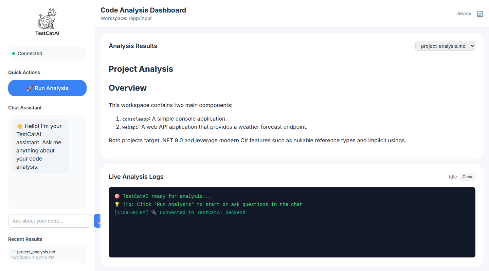
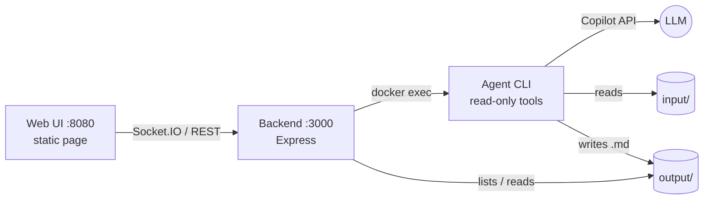

# TestCatAI

A prompt-driven code analysis tool powered by the GitHub Copilot API.
Point it at a folder of code, give it a prompt, and an LLM agent explores the files
with read-only tools and writes Markdown documentation. Use it from the CLI or a web UI.



## How to run

Requires Docker and a GitHub token with Copilot access.

```bash
export GITHUB_TOKEN=<your token>
docker compose up -d --build
```

1. Put the code to analyze into `input/` (prompts live in `prompt/`).
2. Open **http://localhost:8080**, click **Run Analysis** and watch the live logs.
   Results are written to `output/` and listed in the page.
3. Or use the CLI directly:

   ```bash
   docker exec -it testcatai-agent node dist/index.js analyze \
     --workspace ./input --maxIterations 5 --prompt "Describe the architecture"
   ```

   Options: `-w` workspace, `-i` max iterations, `-m` model (default `gpt-4.1`), `-t` token,
   `-s` system prompt, `-p` prompt, `-d` debug.

Local development uses **pnpm**: `pnpm install && pnpm run install:all && pnpm test`.
API docs: http://localhost:3000/swagger.

> Demo tool, not a hardened service: the backend has no authentication and mounts the
> Docker socket. Keep port 3000 on localhost.

## Architecture



| Service | Path | Role |
| --- | --- | --- |
| Agent | `src/agent-service` | CLI loop: calls the model, runs tools (`read_file`, `list_directory`, `save_document`, ...), saves results |
| Backend | `src/backend-service` | Starts the agent, streams its log lines to the browser, serves results |
| Frontend | `src/frontend-service` | Single-page dashboard |

Not implemented yet: chat about a document, retry on Copilot API failure.

## License

MIT
